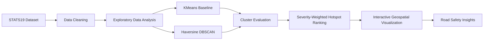
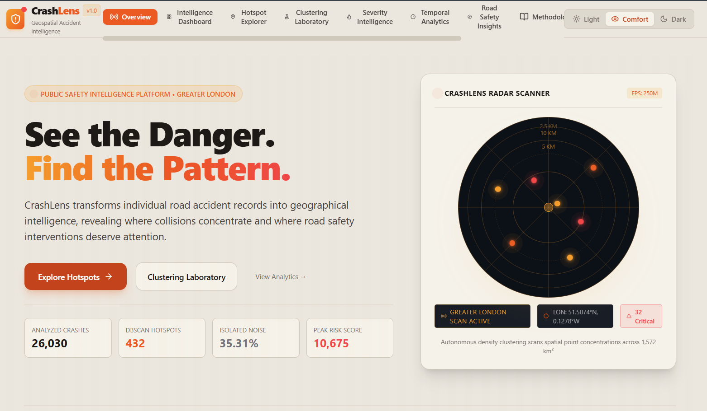
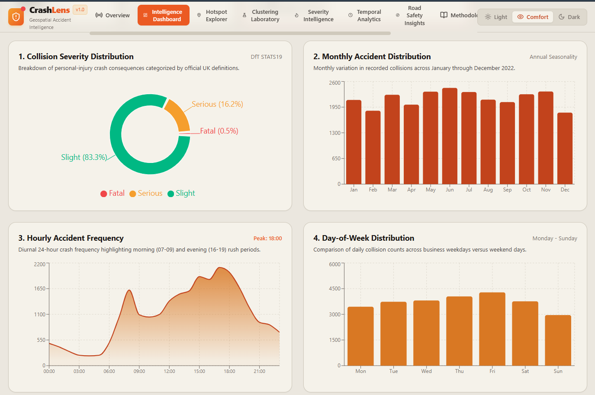
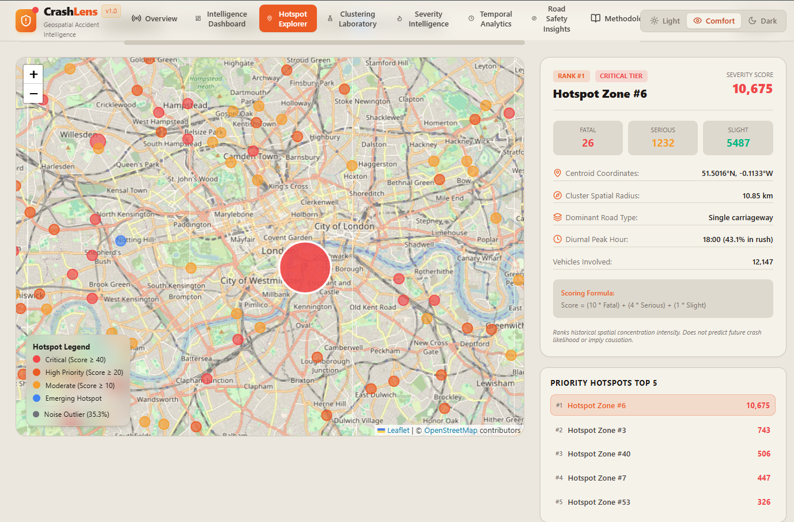
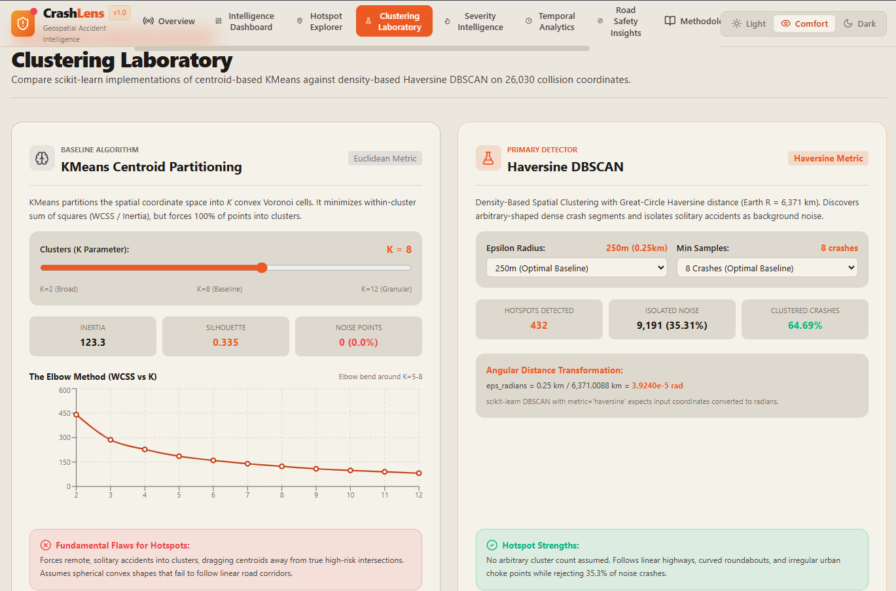
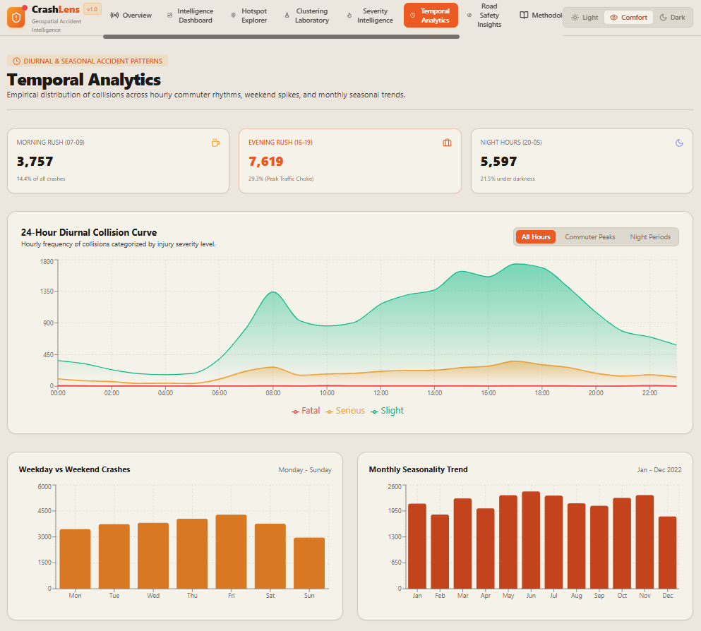

<div align="center">


# CrashLens

### Finding where accidents cluster, not just where they happen.

Turning raw collision records into interactive road-safety intelligence — powered by density-based clustering and geospatial analytics.

<br/>

[](https://nextjs.org/)
[](https://react.dev/)
[](https://www.typescriptlang.org/)
[](https://www.python.org/)
[](https://scikit-learn.org/)
[](https://tailwindcss.com/)
[](https://leafletjs.com/)
[](https://recharts.org/)
[](https://crashlens-snowy.vercel.app/)

<br/>

**[🚀 Live Demo](https://crashlens-snowy.vercel.app/) · [📂 GitHub Repository](https://github.com/dk-khandelwal06/crashlens) · [💼 LinkedIn](https://www.linkedin.com/in/daksh-khandelwal-b02748391/) · [🎥 Demo Video]()**

</div>

<br/>

---

## 📖 Overview

**CrashLens** is a full-stack road-safety intelligence platform that treats road collisions not as isolated pins on a map, but as a spatial pattern waiting to be found. A single accident record tells you almost nothing on its own — a dangerous junction only reveals itself when dozens of incidents concentrate in the same few hundred metres, year after year.

CrashLens applies **density-based clustering (DBSCAN)** — with a true great-circle **Haversine** distance metric — to UK collision data, automatically surfacing the road stretches, junctions, and roundabouts where crashes concentrate most densely, while filtering out sparse, unrelated noise. A **KMeans** baseline runs alongside it so the two approaches can be compared directly, and every hotspot is ranked by a transparent, severity-weighted risk score rather than raw count alone.

The result is an interactive dashboard where the clustering pipeline, the map, the statistics, and the methodology are all one connected story — not a notebook buried in a repo.

---

## 🧭 The Problem

Individual accident records don't reveal *where it's dangerous* — they reveal *where something happened once*. Traffic authorities need to know which specific stretches of road concentrate repeated incidents, because that's where interventions — signage, speed cameras, redesigned junctions — actually move the needle.

The common alternatives fall short:

- **Simple point maps** show volume, not density — a junction with 20 accidents scattered loosely over a kilometre looks identical to 20 accidents packed into 200 metres, even though the second is a far more urgent fix.
- **Aggregate counts** (ward-level, city-level, annual reports) are useful for policy, but too coarse to point to an actual junction or roundabout.

CrashLens exists to close that gap between "an accident happened near here" and "this specific stretch is a hotspot."

---

## 💡 The Solution

CrashLens turns individual collision records into geographic intelligence through a clear, reproducible pipeline:



An offline Python pipeline does the heavy lifting — cleaning, converting coordinates to radians, running both clustering algorithms, scoring and ranking the resulting hotspots — and serializes the results to static JSON/GeoJSON. The Next.js web app then renders that output as a fully interactive experience, with zero server-side ML computation at request time.

---

## ✨ Key Features

- 🎯 **DBSCAN-based hotspot detection** using a true Haversine (great-circle) distance metric, with noise points identified and excluded
- 📊 **KMeans baseline comparison** — elbow method and silhouette score for choosing the right number of clusters
- 🏆 **Severity-weighted hotspot ranking**, prioritizing clusters by collision severity, not just volume
- 🗺️ **Interactive Leaflet map** with layer toggling between DBSCAN clusters, KMeans clusters, and raw incident points
- 🔍 **Cluster selection & filtering** with a dedicated inspector for drilling into a single hotspot
- 📈 **Intelligence dashboard** — severity distribution, road-type and lighting breakdowns
- ⏱️ **Temporal analytics** — hourly, weekday-vs-weekend, and monthly accident patterns
- 🧪 **Clustering laboratory** — interactive KMeans elbow curve and silhouette-score exploration
- 🎨 **Three appearance themes** — Light, Comfort, and Dark
- 🔊 **Browser-based voice narration** of key insights via the Web Speech API

---

## 🖼️ Application Preview

<div align="center">


<p><em>Landing overview — the full CrashLens experience at a glance</em></p>

<br/>


<p><em>Intelligence Dashboard — severity distribution and risk breakdowns</em></p>

<br/>


<p><em>Interactive Hotspot Explorer — Leaflet map with DBSCAN / KMeans / point layers</em></p>

<br/>


<p><em>Clustering Laboratory — elbow method and silhouette score exploration</em></p>

<br/>


<p><em>Temporal Analytics — hourly, weekday, and monthly accident patterns</em></p>

</div>

---

## 🔬 Machine Learning Methodology

### KMeans — Centroid-Based Baseline
A classic partitioning algorithm used here as a comparison baseline. The right number of clusters, *k*, is chosen using the **elbow method** (inertia / WCSS across a range of *k*) together with the **silhouette score**, which measures how well-separated the resulting clusters are.

### DBSCAN — Density-Based Hotspot Detection (Primary Method)
DBSCAN groups points that are densely packed together and explicitly labels sparse, isolated points as **noise** rather than forcing them into a cluster. This makes it the right tool for accident hotspots: real-world danger zones are irregularly shaped (a bent road, a cluster of nearby junctions), and most accidents in a dataset are *not* part of any hotspot at all. KMeans, by contrast, always assigns every point to a cluster and assumes roughly spherical cluster shapes — both are poor fits for this problem, which is why DBSCAN is CrashLens's primary detector and KMeans is kept as a baseline for comparison.

DBSCAN requires two parameters: **epsilon** (the neighbourhood radius) and **minimum samples** (the minimum number of points needed to form a dense region). Because accident coordinates are in latitude/longitude, CrashLens uses scikit-learn's `metric='haversine'`, which requires both the coordinates and epsilon to be expressed in **radians** — plain Euclidean distance on raw degrees would badly distort real-world distances.

**Haversine epsilon conversion:**

```
eps_radians = eps_km / Earth_radius_km
```

where `Earth_radius_km = 6371.0088` (WGS84 mean radius).

---

## 🏆 Severity-Weighted Hotspot Ranking

Rather than ranking hotspots by raw collision count alone, CrashLens scores each cluster using a transparent, severity-weighted formula:

```
Score = (10 × Fatal) + (4 × Serious) + (1 × Slight)
```

This ensures a small cluster with several fatal collisions is surfaced as more urgent than a larger cluster of minor incidents. The resulting score and risk tier are a **transparent historical severity-weighted index** — they describe patterns in past data and are **not** a validated prediction of future crashes.

---

## 📊 Dataset & Data Transparency

- **Source:** UK Department for Transport (DfT) **STATS19 Road Casualty Statistics**
- **Official portal:** [gov.uk — Road Safety Open Data](https://www.gov.uk/government/statistical-data-sets/road-safety-open-data)
- **Licensing:** Open Government Licence v3.0
- **Study area:** Greater London

| Stage | Records |
|---|---|
| Raw records loaded | 106,004 |
| Invalid / missing coordinates rejected | 22 |
| Outside Greater London boundary | 79,952 |
| Retained & clustered | **26,030** |

> **Geographical scope notice:** This release analyzes official UK STATS19 data for Greater London only. It does **not** represent road accident conditions in Jaipur, Rajasthan, India, or anywhere outside its stated study area, and it does not cover every road accident — only those reported to police and recorded under STATS19.

---

## 🛠️ Technology Stack

**Frontend**
Next.js 15 · React 19 · TypeScript · Tailwind CSS

**Visualization**
Leaflet · React-Leaflet · Recharts

**Machine Learning**
Python · Pandas · NumPy · scikit-learn · Matplotlib · Seaborn

**Development & Deployment**
Git · GitHub · Vercel

---

## 🏗️ Architecture

```
STATS19 CSV
   → Python Data Processing (pandas, numpy)
   → Geospatial Cleaning & Validation
   → KMeans + Haversine DBSCAN (scikit-learn)
   → Cluster Evaluation (inertia, silhouette)
   → Severity-Weighted Hotspot Ranking
   → Static JSON / GeoJSON Export
   → Next.js Application (React, Leaflet, Recharts)
   → Interactive User Experience
```

The Python machine-learning pipeline runs **offline** and produces static JSON/GeoJSON artifacts consumed by the web application. Vercel serves the pre-built Next.js app and does **not** execute the Python clustering pipeline at runtime.

---

## ⚙️ Local Installation & Setup

### Prerequisites
- Node.js v18.18+
- npm v10+
- Python 3.10+

### 1. Clone the repository
```bash
git clone https://github.com/dk-khandelwal06/crashlens.git
cd crashlens
```

### 2. Install frontend dependencies
```bash
npm install
```

### 3. Install Python dependencies
```bash
pip install -r requirements.txt
```

### 4. Run the machine-learning pipeline
```bash
python python/src/run_pipeline.py
```

### 5. Start the development server
```bash
npm run dev
```

Open **[http://localhost:3000](http://localhost:3000)** in your browser.

---

## 🚀 Deployment

CrashLens is deployed on **[Vercel](https://vercel.com)** directly from this GitHub repository. Vercel auto-detects the Next.js framework, builds with `npm run build`, and serves the static `.next` output — including the pre-generated STATS19 clustering results in `public/data/`.

🔗 **Live:** [crashlens-snowy.vercel.app](https://crashlens-snowy.vercel.app/)

---

## 🔒 Security & Data Ethics

- No hardcoded API keys or secret credentials in client code
- Environment variables handled via `.env.local` / `.env.example`, excluded from version control
- Raw dataset files excluded from the repository via `.gitignore`
- Built entirely on public, open-licensed government data (OGL v3.0)
- STATS19 is historical, aggregate collision data with no personal identifiers in the analytical dataset

---

## 🔭 Future Scope

> The following are potential future directions, not implemented features.

- Point-level Indian accident datasets, once reliable public sources become available
- HDBSCAN as an alternative to fixed-epsilon DBSCAN
- Spatiotemporal clustering (combining location with time-of-day/season)
- Improved severity-weighted density analysis
- Geospatial polygon-level analysis (ward/borough boundaries)
- Integration of additional environmental and road-infrastructure factors

---

<div align="center">

## 👤 Author

**Daksh Khandelwal**

[](https://www.linkedin.com/in/daksh-khandelwal-b02748391/)
[](https://github.com/dk-khandelwal06)

<br/>

*Built to turn road accident data into meaningful geographical intelligence.*

</div>
